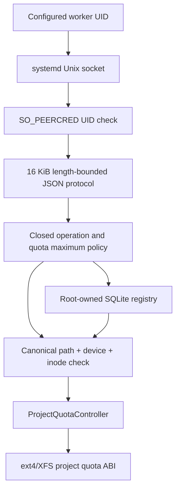

# Architecture

## Scope

`linux-project-quota` contains two Linux-specific layers:

1. `ProjectQuotaController`: direct ext4/XFS project quota operations against one exact mounted filesystem.
2. `project-quota-helper`: a privileged systemd socket-activated service that constrains an unprivileged worker to a narrow request set.

It is not a cgroup controller and does not manage mounts or systemd configuration.

## Module/API map

| Surface | Responsibility |
|---|---|
| `ProjectQuotaController::open` | Resolve and validate a real directory under an ext4/XFS block-device mount with project-quota mount options; probe quota query support. |
| `assign_project_id[_exact]` | Apply project ID and inheritance flag to a new empty child directory. |
| `set_hard_limits[_exact]` | Set byte/inode hard limits and immediately read back kernel state. |
| `status` / `verify_hard_limits[_exact]` | Read current usage and verify requested limits. |
| `clear_empty_project` | Clear quota limits only after kernel reports zero charged bytes and inodes. |
| `UnixProjectQuotaBackend` | Length-bounded Unix-socket client for the helper. |
| `serve_systemd_quota_helper` | Verify systemd activation, check `SO_PEERCRED` UID, validate requests, consult registry, and dispatch constrained operations. |
| `project-quota-helper` | Parse required environment configuration and start the helper loop. |

## Filesystem ABI

The crate uses Linux `quotactl(Q_GETQUOTA/Q_SETQUOTA)` for `Q_PROJ` and `FS_IOC_FSGETXATTR/FS_IOC_FSSETXATTR` to read/write project ID and inheritance metadata. ABI structures use `repr(C)`; unsafe blocks are narrowly scoped to syscalls/ioctls and kernel socket credential retrieval.

The mount detector supports ext4 and XFS with `prjquota`/`pquota` enabled in mount/superblock options. It rejects other filesystem types, non-block-device sources, symlink roots, and nested workspace paths outside the configured root.

## Privileged helper boundary

- The Unix socket must be created by systemd. Helper refuses self-created/non-activated listener operation.
- Exactly one listener descriptor is accepted (`LISTEN_PID` matches and `LISTEN_FDS=1`).
- Each accepted peer must match the configured worker UID (`SO_PEERCRED`).
- Request and response frames are 4-byte big-endian length prefixes, maximum 16 KiB, JSON closed enums/structs.
- Operations are limited to probe, assign, set, verify directory, verify limits, status, and clear-empty.
- Paths must be absolute, normalized, worker-owned, non-group/world-writable, beneath the configured root, and exactly match `.project-quota-workspaces/execution-<project-id>`.
- The registry binds project IDs to exact path/device/inode, limits, and monotonic states. Released IDs are terminal and never reused.
- The helper enforces administrator-configured maximum byte/inode limits.

## Registry

The helper requires a root-owned mode-`0700` parent directory and opens SQLite with `SQLITE_OPEN_NOFOLLOW`. It configures WAL, `synchronous=FULL`, foreign keys, a busy timeout, immutable identity/limit triggers, no-delete trigger, and monotonic state transitions.

The registry is host security state. Back it up and protect it as carefully as other privileged service state. Do not copy a production registry between mounts or restore it without reconciling kernel project IDs and filesystem identities.

## Explicit exclusions

The upstream destructive quota integration executable is not part of this repository. It creates files until byte/inode quotas are exhausted, exercises cleanup, and permanently consumes test project IDs. Real ext4/XFS enforcement testing requires a dedicated disposable mount and explicit operator control; it is not a default test or CI action.
